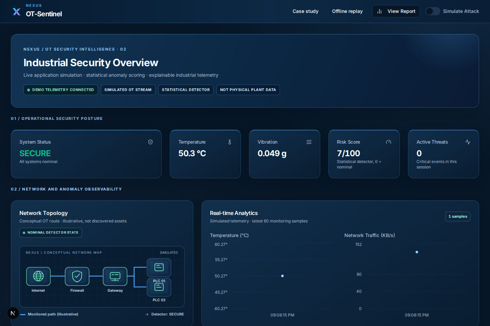
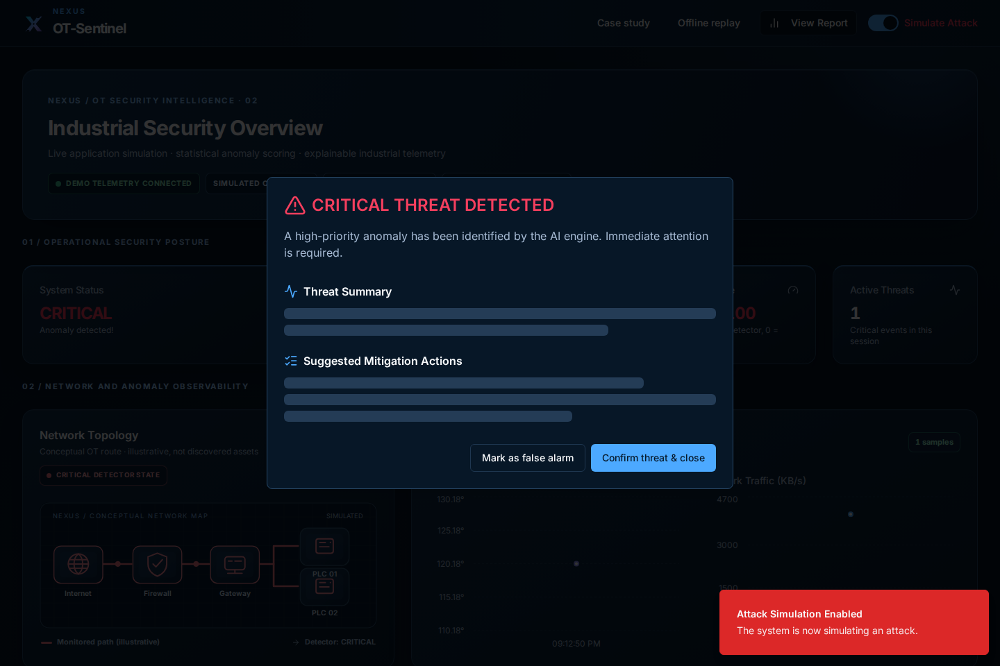
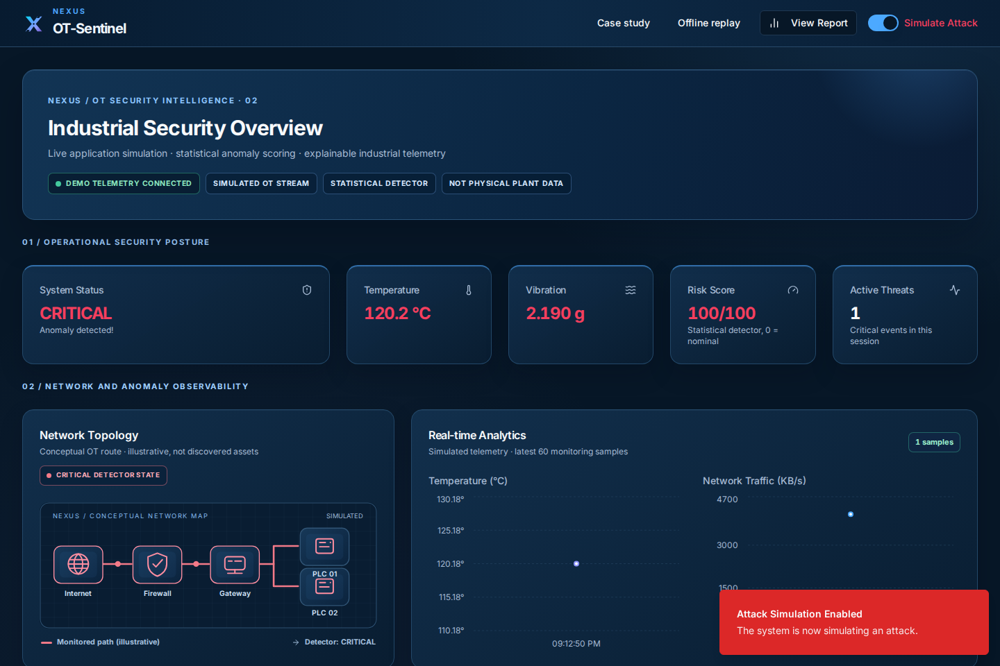
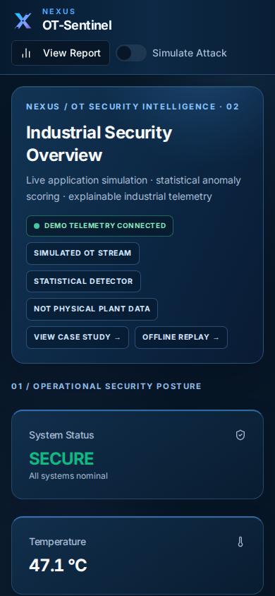
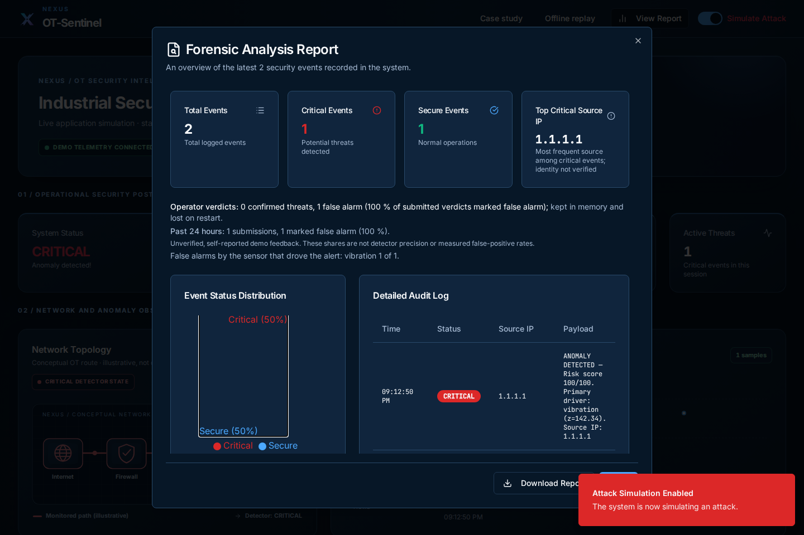

# OT-Sentinel

<p align="right"></p>

[](https://github.com/senanurcetin/ot-sentinel/actions/workflows/ci.yml)
[](https://github.com/senanurcetin/ot-sentinel/actions/workflows/e2e-tests.yml)
[](https://github.com/senanurcetin/ot-sentinel/actions/workflows/security-checks.yml)


**An explainable anomaly dashboard for industrial (OT) telemetry:** a statistical detector decides whether a reading is anomalous and which sensors drive it, and an LLM only explains that verdict, with a rule-based fallback when the LLM is unavailable.

## Key results

Seven detectors evaluated on the public [BATADAL](https://www.batadal.net/data.html) water-distribution attack benchmark (43 signals, hourly, 14 attacks in two files), all held to the **same false-alarm budget**. Detectors learn from a year of attack-free data; the headline is a later, unseen test file. Protocol v3 was [fixed before its first run](docs/protocol-v3.md).

<!-- BEGIN results:summary (generated by analysis/results_report.py) -->
**Test set (attacks 8-14, Jan-Mar 2017): headline** - 7 attacks, 407 attack hours (19.5 % of 2089); a random guess scores a PR-AUC of about 0.195.

| Detector | Attacks caught | Expected from false alarms alone | Median hours to detect | Alarm hours in attack-free data | Precision | Attack hours caught | PR-AUC | PR-AUC 95 % interval |
|---|---:|---:|---:|---:|---:|---:|---:|---:|
| Static limits | 7 of 7 | 6.3 | 2 | 18.3 % | 34.1 % | 39.1 % | 0.387 | 0.246 to 0.528 |
| Max absolute z-score | 7 of 7 | 6.3 | 1 | 5.2 % | 54.9 % | 26.0 % | 0.427 | 0.264 to 0.573 |
| EWMA of z-scores (v3) | 7 of 7 | 5.9 | 5 | 27.5 % | 29.6 % | 47.9 % | 0.391 | 0.217 to 0.563 |
| CUSUM (v3) | 7 of 7 | 3.3 | 0 | 78.2 % | 22.2 % | 92.1 % | 0.207 | 0.122 to 0.325 |
| 24 h rolling residual (v3) | 7 of 7 | 6.3 | 1 | 8.0 % | 43.5 % | 25.6 % | 0.316 | 0.190 to 0.481 |
| Isolation Forest | 7 of 7 | 6.2 | 4 | 6.5 % | 32.1 % | 12.8 % | 0.248 | 0.155 to 0.350 |
| Gradient boosting (supervised) † | 7 of 7 | 6.2 | 3 | 6.3 % | 39.1 % | 16.7 % | 0.322 | 0.190 to 0.451 |

**dataset04 (attacks 1-7, Jul-Dec 2016): secondary** - 7 attacks, 492 attack hours (11.8 % of 4177); a random guess scores a PR-AUC of about 0.118.

| Detector | Attacks caught | Expected from false alarms alone | Median hours to detect | Alarm hours in attack-free data | Precision | Attack hours caught | PR-AUC | PR-AUC 95 % interval |
|---|---:|---:|---:|---:|---:|---:|---:|---:|
| Static limits | 7 of 7 | 6.6 | 3 | 18.7 % | 23.8 % | 43.7 % | 0.285 | 0.151 to 0.412 |
| Max absolute z-score | 7 of 7 | 6.5 | 2 | 5.3 % | 44.7 % | 31.9 % | 0.437 | 0.287 to 0.567 |
| EWMA of z-scores (v3) | 7 of 7 | 6.3 | 6 | 21.1 % | 29.7 % | 66.7 % | 0.586 | 0.409 to 0.729 |
| CUSUM (v3) | 7 of 7 | 4.2 | 0 | 76.0 % | 15.0 % | 100.0 % | 0.261 | 0.150 to 0.424 |
| 24 h rolling residual (v3) | 7 of 7 | 6.3 | 5 | 6.8 % | 47.9 % | 47.2 % | 0.476 | 0.291 to 0.643 |
| Isolation Forest | 7 of 7 | 6.6 | 5 | 8.4 % | 26.9 % | 23.2 % | 0.196 | 0.119 to 0.279 |
| Gradient boosting (supervised) † | not evaluated here: trained on this data | | | | | | | |

† trained on dataset04 with the published attack intervals and evaluated on the test set only; an optimistic reference, not a deployable detector.
<!-- END results:summary -->

<!-- BEGIN results:v3-decision (generated by analysis/results_report.py) -->
Protocol v3 decision rule (fixed in advance in `docs/protocol-v3.md`): a temporal detector beats max absolute z-score only if the 95 % interval of its paired PR-AUC difference on the test set lies entirely above 0 (1000 day-block bootstrap resamples). Result: no temporal detector passes; there is no detectable improvement over max absolute z-score on the test set.

| Detector | PR-AUC minus max absolute z-score, 95 % interval | Better than max absolute z-score? |
|---|---:|:---:|
| EWMA of z-scores (v3) | -0.088 to 0.041 | no |
| CUSUM (v3) | -0.377 to -0.042 | no |
| 24 h rolling residual (v3) | -0.180 to -0.021 | no |
<!-- END results:v3-decision -->

How to read it:

- **"Attacks caught" says little.** False alarms alone would land in almost every attack (attacks last 24-110 hours); use precision, attack hours caught and PR-AUC against the random-guess value.
- **Adding time did not help.** No temporal detector beats the z-score on the test file and two are worse; the EWMA does better only on the 2016 file.
- **The explanations mostly point at the right equipment.** During an attack the z-score's three strongest signals include an attacked one roughly three times as often as chance, except for attacks that replay normal readings ([details](docs/case-study.md#does-the-explanation-point-at-the-attacked-equipment)).

Per-attack tables, data drift and the protocol amendment: [case study](docs/case-study.md) · [model card](MODEL_CARD.md).

## Demo



| Alert with rule-based guidance | Why this score? |
|---|---|
|  |  |

<details><summary>Mobile (390 × 844) and forensic report</summary>





</details>

Older 35 s walkthrough (normal → simulated attack → alert → forensic report, rule-based guidance): [`docs/assets/ot-sentinel-demo.webm`](docs/assets/ot-sentinel-demo.webm).

## Quick start

```bash
npm install
cp .env.example .env     # optional: add GEMINI_API_KEY; without it the rule-based fallback is used
npm run dev              # http://localhost:9002 , toggle "Simulate Attack"
```

Docker:

```bash
docker build -t ot-sentinel .
docker run --rm -p 9002:9002 -e GEMINI_API_KEY=your-key -v ot-sentinel-data:/data ot-sentinel  # volume keeps verdicts
```

Quality checks:

```bash
npm run lint
npm run typecheck        # includes test files
npm run test:coverage    # Jest + coverage thresholds
npm run build
npm run test:e2e         # Playwright; run `npx playwright install chromium` once
E2E_BASE_URL=https://your-deployment npm run test:e2e   # same suite against a deployed instance
cd analysis && pip install -r requirements-dev.txt && ruff check . && pytest
```

## Details

### What it does

- Streams simulated temperature, pressure, vibration and traffic readings once a second and scores each sample against an attack-free baseline, showing per-sensor z-scores and each sensor's share of the risk score.
- On a CRITICAL sample, opens an alert with a summary and suggested actions, written by Gemini when available and by the rule-based fallback otherwise; the dialog says which.
- Lets a user mark an alert as a confirmed threat or false alarm (`POST /api/feedback`). The forensic report shows the share marked false alarm per sensor (`GET /api/feedback/summary`, aggregates only). Stored in SQLite when `FEEDBACK_DB_PATH` is set (default in the Docker image), in memory otherwise ([contract](docs/operator-feedback-analytics.md)).
- Simulates an attack on demand and exports a forensic report as CSV (spreadsheet-formula safe).
- [`/offline-replay`](https://github.com/senanurcetin/ot-sentinel/blob/main/docs/LOCAL_REPLAY_WORKBENCH.md): a browser-only workbench for checksummed three-sensor JSON recordings ([contract](docs/OFFLINE_REPLAY_CONTRACT.md)). It never uploads a file and can export a JSON report of reviewed windows with checksum provenance.

### BATADAL research pages

- [`/batadal-history`](docs/BATADAL_VERIFIED_HOURLY.md): **660 hourly rows** from the official 2016 dataset04 around seven attacks, with 12 hours of context on each side and all 43 signals. The source CSV's SHA-256 matches the pinned analysis digest; regenerate with `analysis/export_verified_hourly.py` and your own copy of `BATADAL_dataset04.csv` (no raw CSV is stored).
- [`/batadal-test-history`](docs/BATADAL_VERIFIED_TEST_HOURLY.md): **575 hourly readings** from the SHA-256-verified 2017 test ZIP around attacks 8–14, all 43 channels, no interpolation. Attack intervals come from the published annotations because the ZIP is unlabelled. Re-check with `python3 analysis/export_official_test_hourly.py --check`.
- Both pages have a retrospective detector selector: a dashed marker shows the first alarm time reported by the offline evaluation, alongside false alarms/day and expected hits from chance. The supervised reference is unavailable on the 2016 training period.
- [`/batadal-explorer`](docs/BATADAL_EVIDENCE_EXPLORER.md) (linked from `/case-study`): compare detectors on the 2017 test or 2016 file, read attack descriptions and outcomes, and browse the 43-signal feature inventory and top drift features from the committed offline results.

Data: BATADAL / Taormina et al. (2018), [CC BY 4.0](https://github.com/scy-phy/www.batadal.net/blob/master/LICENSE.md); adaptations are documented on each page.

### Architecture

Next.js App Router (React 19, TypeScript), Genkit + Gemini 2.5 Flash, Tailwind + shadcn/ui, Recharts, zod. [`analysis/`](analysis/README.md) holds the Python evaluation pipeline and generates the detector constants in `src/data/model/scorer-params.json` (`analysis/export_model.py`); the model card parameter table comes from the same file and `pytest` fails if either goes stale. Diagrams and the alert sequence: [`docs/architecture.md`](docs/architecture.md). More docs: [documentation guide](docs/README.md).

| Path | What |
|---|---|
| `src/app/` | pages and API routes (`/api/metrics`, `/api/feedback`, `/api/health`) |
| `src/lib/` | scorer, telemetry source, fallback guidance, rate limiter, security headers, CSV export |
| `src/ai/flows/` | Genkit flow behind the alert dialog |
| `src/components/` | dashboard UI |
| `analysis/` | evaluation pipeline, model-constants export, Python tests |
| `tests/e2e/` | Playwright tests |
| `docs/` | [architecture](docs/architecture.md), [threat model](docs/threat-model.md), [case study](docs/case-study.md), [archived original spec](docs/archive/blueprint.md) |

### Security and demo access

Security headers and CSP, per-client rate limits, validated inputs, a model timeout with fallback, and CSV formula-injection protection. Scope, residual risks and an ATT&CK for ICS mapping: [threat model](docs/threat-model.md). Report issues via [`SECURITY.md`](SECURITY.md).

Set `DEMO_BASIC_AUTH=username:random-secret-of-at-least-16-chars` at runtime to put application pages, API routes and the AI server action behind a shared HTTP Basic challenge. Leave it absent for the open demo; an empty or malformed value fails closed (503). `/api/health` and static assets stay public. Failed guesses are capped per server instance without trusting forwarded-IP headers. See [demo access and deployment security](docs/demo-access.md).

### CI and deployment checks

Automatic PR jobs run in CircleCI (`web-quality`, `analysis-quality`, `browser-e2e`); GitHub runs Docker, CodeQL, `npm audit`, `pip-audit` and secret scanning (plus weekly scans), and keeps its web/Python/browser workflows as manual fallbacks ([CI coverage contract](docs/ci-coverage-contract.md)).

A read-only smoke check verifies a deployed preview at an exact commit:

```bash
DEPLOYMENT_SMOKE_URL=https://your-exact-preview.vercel.app \\
DEPLOYMENT_SMOKE_EXPECTED_SHA=<full-40-character-git-commit-sha> \\
npm run smoke:deployment
```

It requires the full 40-character SHA before any request, never follows redirects, rejects SSO login HTML even on HTTP 200, and checks `/`, `/offline-replay`, `/batadal-explorer`, `/batadal-history`, `/batadal-test-history`, `/case-study` and `/api/health` on one origin. A missing or mismatched commit, a login challenge or an unavailable route fails. Optional `DEPLOYMENT_SMOKE_COOKIE` or `DEPLOYMENT_SMOKE_BYPASS` values are never printed. `npm run test:deployment-smoke` tests the checker offline in CI. Protected-preview and release acceptance is tracked in [issue #72](https://github.com/senanurcetin/ot-sentinel/issues/72).

### Related work

[Vision2DCS](https://github.com/senanurcetin/Vision2DCS) has a rule-based "OT Sentinel" audit of P&ID extractions (ISA-5.1 tag naming, safety-function keywords, loop integrity) — a different tool from this telemetry detector.

## Limitations

- **Demo only.** Live telemetry is synthetic with three sensors; there are no real protocol adapters, and it must not be connected to a PLC, DCS or live control system. The LLM never makes detection or control decisions.
- **Modest detection.** The best detector flags a minority of attack hours and is right about half the time it alarms; no detector is near a deployable operating point. The CUSUM alarms in most attack-free hours.
- **Small sample.** Seven attacks per file make detector differences anecdotal; intervals are wide and overlap, and even the z-score's lead over static limits on the test file is not established.
- **Drift.** The attack-free reference is from 2014, the evaluation files from 2016-2017, and one pressure signal drifted ([data drift](docs/case-study.md#data-drift)); part of every false-alarm figure is that shift.
- **The dashboard scorer is not what was measured.** BATADAL evaluates the method on 43 signals offline; the live scorer is a 3-signal, per-sample static baseline with no missing-data or stuck-value detection. The supervised gradient-boosting row is an optimistic reference, not a deployable detector.
- **The history pages are excerpts.** Attack windows only: no full-horizon replay, no new model inference, no hourly risk curve, and source timestamps have no declared timezone (not UTC).
- **Operator verdicts are self-reported labels**, not verified ground truth or a detector metric, and are not yet used to tune anything.
- **Demo access is not access control.** The shared password has no user-level authorization, SSO, audit identity or distributed throttling, and its global failure counter lets an attacker lock out all users. Use provider SSO/VPN and an ingress WAF for public access.
- **Not released to production.** Green CI or a `READY` preview is not release acceptance; authenticated browser/accessibility checks, origin authorization, API write protection and rollback rehearsal remain open ([#72](https://github.com/senanurcetin/ot-sentinel/issues/72)).

## License

[MIT](LICENSE)
