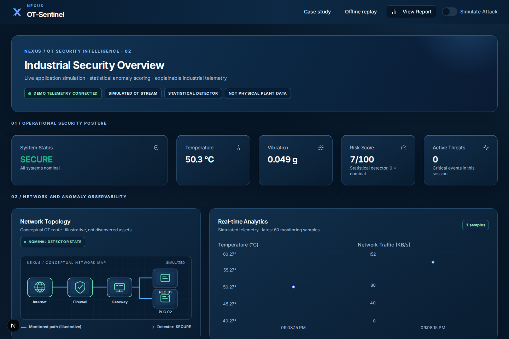
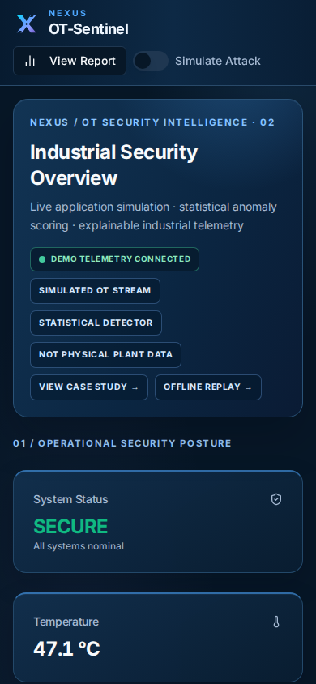
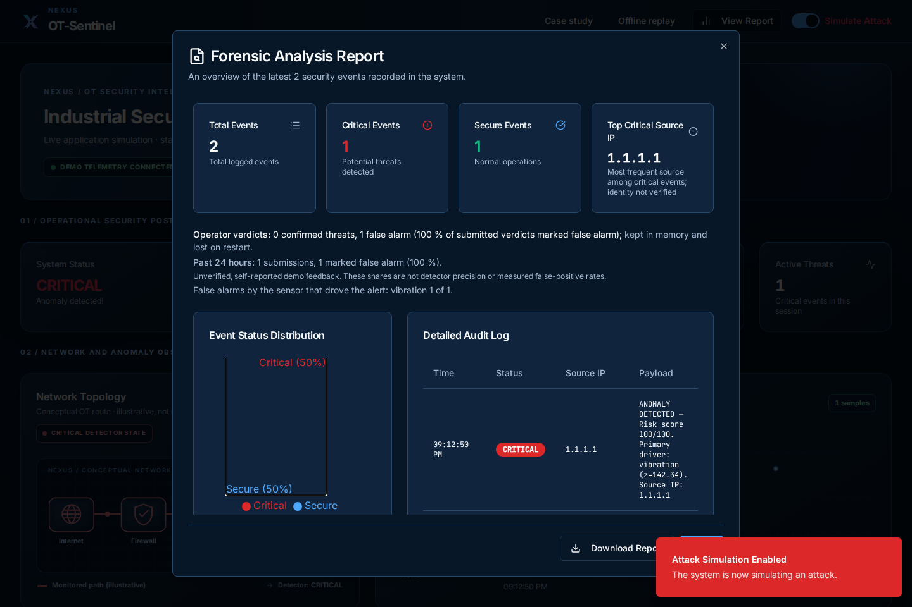
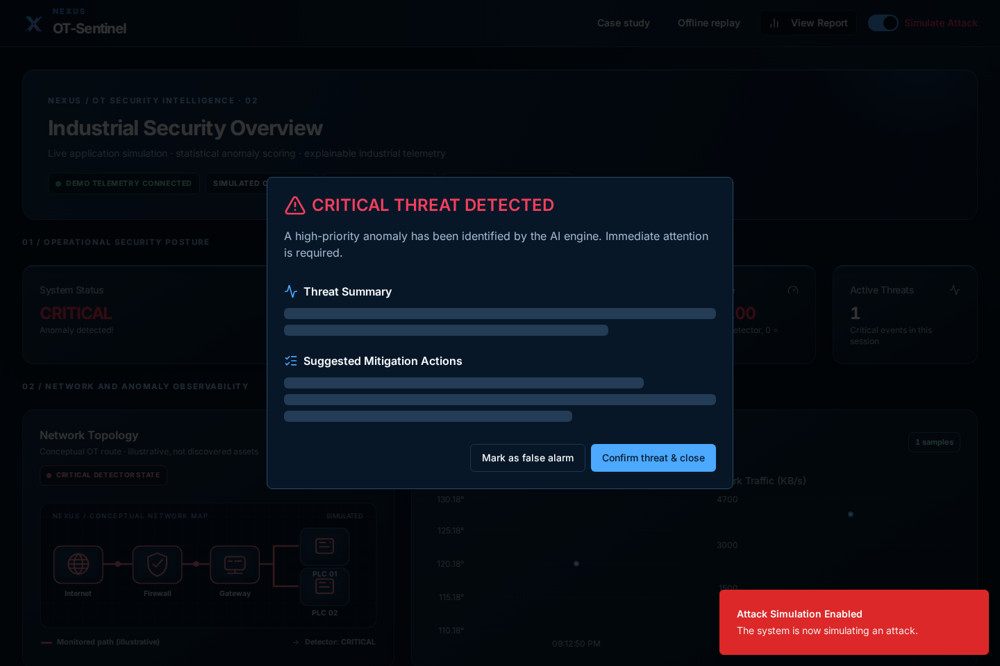
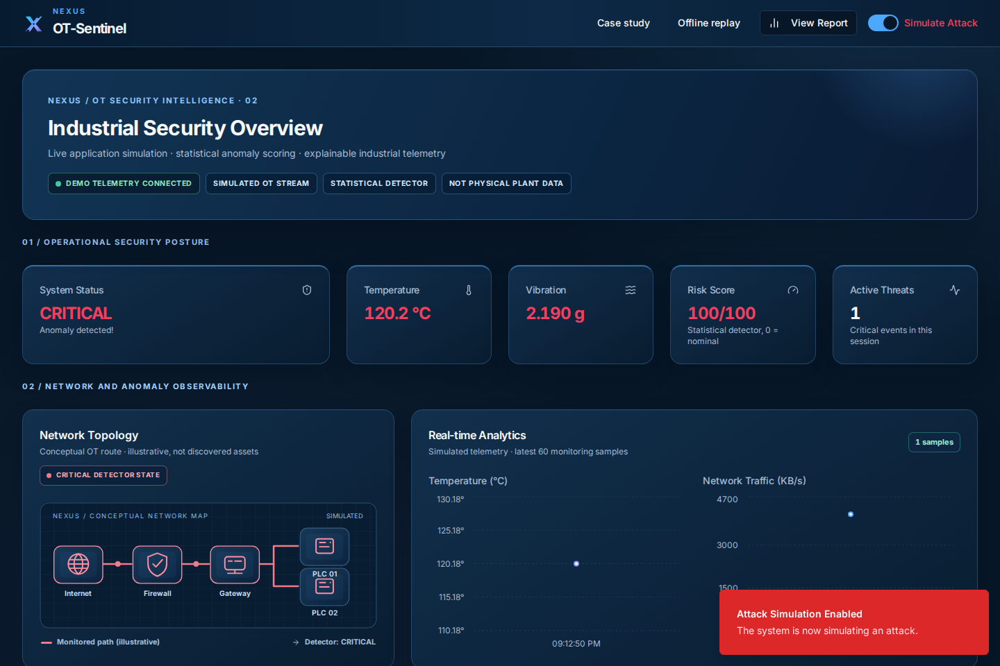

# OT-Sentinel

<p align="right"></p>

[](https://github.com/senanurcetin/ot-sentinel/actions/workflows/ci.yml)
[](https://github.com/senanurcetin/ot-sentinel/actions/workflows/e2e-tests.yml)
[](https://github.com/senanurcetin/ot-sentinel/actions/workflows/security-checks.yml)


**An explainable anomaly dashboard for industrial (OT) telemetry.** A statistical detector decides
whether a reading is anomalous and which sensors drive it; an LLM turns that verdict into
operator-friendly triage; a deterministic fallback keeps the guidance useful when the LLM is
unavailable. The live demo runs on simulated telemetry; the detector method is evaluated on the
public BATADAL attack benchmark (see [Evaluation](#evaluation)).


<sub>Actual local Chromium captures of the synthetic OT stream. They do not show live PLCs, a production plant, or a validated active attack.</sub>

<details><summary>Mobile NEXUS dashboard · 390 × 844</summary>



</details>



Earlier walkthrough video (archival recording made before the current NEXUS screenshots): [`docs/assets/ot-sentinel-demo.webm`](docs/assets/ot-sentinel-demo.webm) (about 35 s: normal operation → simulated attack → alert → forensic report). It was recorded without a Gemini key, so the alert shows the rule-based guidance, not an AI answer.

Reviewing this project? Start with the [case study](docs/case-study.md) and the [reviewer summary](docs/hiring-summary.md).

## Protected preview release acceptance

With SSO-protected hosting, `READY` alone is not proof of an authenticated application route. The repository provides an opt-in, **read-only** route and JSON health checker:

```bash
DEPLOYMENT_SMOKE_URL=https://your-exact-preview.vercel.app \\
DEPLOYMENT_SMOKE_EXPECTED_SHA=<full-40-character-git-commit-sha> \\
npm run smoke:deployment
```

Run after obtaining legitimate access through the hosting provider. Optionally supply an authorized cookie in `DEPLOYMENT_SMOKE_COOKIE` or an explicitly approved preview bypass token in `DEPLOYMENT_SMOKE_BYPASS`; neither value is written to output. The CLI requires an explicit, full 40-character `DEPLOYMENT_SMOKE_EXPECTED_SHA` before any HTTP request. The health API publishes a public Git commit only when supplied by Vercel/CI (otherwise `commit: null`); an older READY preview, missing SHA, or mismatched commit **fails closed**, even if its `/api/health` version is identical. The script never follows redirects, rejects SSO login HTML even when HTTP 200, and checks `/`, `/offline-replay`, `/batadal-explorer`, `/batadal-history`, `/batadal-test-history`, `/case-study`, and `/api/health` on the same origin. A login challenge or an unavailable route is a **release blocker**, not a green result. `npm run test:deployment-smoke` tests the checker offline and runs in CI.

Route and health success do not replace authenticated browser visual/accessibility checks, origin authorization, API write protection or rollback rehearsal; do not promote the preview until those are independently evidenced.

## Status

| Part | State |
|---|---|
| Dashboard, detector, explanation, fallback, operator feedback | working, tested |
| Live demo telemetry | **synthetic**; the BATADAL evaluation is offline: its results are shown on the app's `/case-study` page, the live scorer does not use it |
| Detector comparison on BATADAL (14 real-benchmark attacks) | run, results below; honest reading: modest, see caveats |
| Operator verdict storage | SQLite when `FEEDBACK_DB_PATH` is set (default in the Docker image), memory otherwise |
| Demo access | optional shared-password gate; disabled unless explicitly configured; not SSO or OT authorization |
| Real protocol adapters | not implemented |

Portfolio role: `OT-security case study`.

## Why this project exists

Plant teams often have monitoring signals but no clear workflow for interpreting an anomaly,
judging severity and recording what was done. OT-Sentinel explores one answer: keep detection simple
and auditable, make the reason for every alert visible, and use an LLM only to explain, never to decide.

## What it does

- Streams (simulated) temperature, pressure, vibration and traffic readings once a second.
- Scores every sample against an attack-free baseline and shows **why**: per-sensor z-score and each sensor's share of the risk score.
- On a CRITICAL sample, opens an alert with a summary and suggested actions. Gemini writes it when available; otherwise a rule-based fallback does, and the dialog says which one you are reading.
- Lets the operator mark each alert as a confirmed threat or a false alarm (`POST /api/feedback`). Each verdict keeps the
  risk score and the sensor that drove the alert; the forensic report shows the false-alarm share per sensor
  (`GET /api/feedback/summary`, aggregates only). Stored in SQLite when `FEEDBACK_DB_PATH` is set, in memory otherwise.
- Simulates an attack on demand, and exports a forensic report as CSV (spreadsheet-formula safe).
- Includes a [local browser-only offline replay workbench](https://github.com/senanurcetin/ot-sentinel/blob/main/docs/LOCAL_REPLAY_WORKBENCH.md) (`/offline-replay` in the running app) for independently checksummed three-sensor JSON recordings; it never uploads a file or connects to an OT network, and is separate from the BATADAL 43-signal evaluation.
  The workbench can also export a local **reviewed-window-only JSON report** of historical demo scores and recording checksum provenance, not a signed forensic record.

| Alert with rule-based guidance | Why this score? |
|---|---|
|  |  |

## Genuine publisher-verified BATADAL hourly history

The separate [`/batadal-history`](docs/BATADAL_VERIFIED_HOURLY.md) route
uses a compact derived artifact of **660 authentic hourly recorded rows** from
the official 2016 BATADAL dataset04, covering seven attacks with 12 actual
hours of context on either side. All 43 original signal values are preserved
for those windows and the original CSV's SHA-256 matched the independently
pinned analysis source digest. Source timestamp timezone is unspecified;
timestamps are not declared UTC. This is offline simulated water-network
research data, **not** live PLC readings, model predictions or 2017 test replay.

Source credit and license: BATADAL / Taormina et al. (2018), publisher
[CC BY 4.0](https://github.com/scy-phy/www.batadal.net/blob/master/LICENSE.md).
All adaptations to the public dataset are disclosed in the linked documentation.

Regenerate/verify using `analysis/export_verified_hourly.py` with your
own original matching BATADAL_dataset04.csv; no raw original CSV is stored.

The distinct [`/batadal-test-history`](docs/BATADAL_VERIFIED_TEST_HOURLY.md)
route shows **575 genuine 2017 unseen-test hourly readings** derived from the
SHA-256-verified publisher ZIP, around seven attacks 8–14. It retains all
43 source channels and 12 hours of context on each side; the ZIP is
**unlabelled**, so attack intervals are independently published annotations,
not test-file predictions. Source timezone is unspecified, no values are
interpolated, and there is **no new model inference**. Re-check with
`python3 analysis/export_official_test_hourly.py --check`.


The 2016 and 2017 historical graph pages also offer a **retrospective
detector selector**. A dashed marker identifies the first alarm time
already reported by the offline benchmark evaluation; it does not create
an hourly risk-score curve or perform test-set inference. For honest
interpretation, the display shows false alarms/day and expected event
hits from chance alongside the marker. The supervised reference is
unavailable when viewing the 2016 training period.

## BATADAL evidence explorer

Open [`/batadal-explorer`](docs/BATADAL_EVIDENCE_EXPLORER.md) through the
case-study page. This independent research view lets reviewers select the
2017 unseen test or 2016 secondary evaluation, compare evaluated detectors,
inspect attack descriptions and measured outcomes, and browse the **actual
43-signal feature inventory** and published top drift features.

It displays **committed offline summary results**, not raw hourly curves:
no plant measurements, PLC traffic, or live model inference are simulated
or asserted by this view. The existing three-sensor dashboard remains
separate and synthetic.

## Architecture

Next.js App Router (React 19, TypeScript), Genkit + Gemini 2.5 Flash, Tailwind + shadcn/ui,
Recharts, zod. Python (`analysis/`) holds the evaluation pipeline and generates the detector's
constants. Diagrams and the alert sequence are in [`docs/architecture.md`](docs/architecture.md).

The detector's parameters live in `src/data/model/scorer-params.json`, generated by
`analysis/export_model.py`; the [model card](MODEL_CARD.md) parameter table is generated from the
same file, and `pytest` fails if either goes stale.

## Evaluation

[`analysis/`](analysis/README.md) compares seven detectors on the public
[BATADAL](https://www.batadal.net/data.html) water-distribution attack benchmark (43 signals,
hourly, 14 attacks in two files): four per-hour detectors (protocol v2) and three that use time (protocol v3,
[fixed before its first run](docs/protocol-v3.md)). Detectors learn from a year of attack-free data, every one is
held to the **same false-alarm budget**, and results are reported separately on a later, unseen test file
(headline) and on the training file of the benchmark. Ground truth is the published attack intervals.

<!-- BEGIN results:summary (generated by analysis/results_report.py) -->
**Test set (attacks 8-14, Jan-Mar 2017): headline** - 7 attacks, 407 attack hours (19.5 % of 2089); a random guess scores a PR-AUC of about 0.195.

| Detector | Attacks caught | Expected from false alarms alone | Median hours to detect | Alarm hours in attack-free data | Precision | Attack hours caught | PR-AUC | PR-AUC 95 % interval |
|---|---:|---:|---:|---:|---:|---:|---:|---:|
| Static limits | 7 of 7 | 6.3 | 2 | 18.3 % | 34.1 % | 39.1 % | 0.387 | 0.246 to 0.528 |
| Max absolute z-score | 7 of 7 | 6.3 | 1 | 5.2 % | 54.9 % | 26.0 % | 0.427 | 0.264 to 0.573 |
| EWMA of z-scores (v3) | 7 of 7 | 5.9 | 5 | 27.5 % | 29.6 % | 47.9 % | 0.391 | 0.217 to 0.563 |
| CUSUM (v3) | 7 of 7 | 3.3 | 0 | 78.2 % | 22.2 % | 92.1 % | 0.207 | 0.122 to 0.325 |
| 24 h rolling residual (v3) | 7 of 7 | 6.3 | 1 | 8.0 % | 43.5 % | 25.6 % | 0.316 | 0.190 to 0.481 |
| Isolation Forest | 7 of 7 | 6.2 | 4 | 6.5 % | 32.1 % | 12.8 % | 0.248 | 0.155 to 0.350 |
| Gradient boosting (supervised) † | 7 of 7 | 6.2 | 3 | 6.3 % | 39.1 % | 16.7 % | 0.322 | 0.190 to 0.451 |

**dataset04 (attacks 1-7, Jul-Dec 2016): secondary** - 7 attacks, 492 attack hours (11.8 % of 4177); a random guess scores a PR-AUC of about 0.118.

| Detector | Attacks caught | Expected from false alarms alone | Median hours to detect | Alarm hours in attack-free data | Precision | Attack hours caught | PR-AUC | PR-AUC 95 % interval |
|---|---:|---:|---:|---:|---:|---:|---:|---:|
| Static limits | 7 of 7 | 6.6 | 3 | 18.7 % | 23.8 % | 43.7 % | 0.285 | 0.151 to 0.412 |
| Max absolute z-score | 7 of 7 | 6.5 | 2 | 5.3 % | 44.7 % | 31.9 % | 0.437 | 0.287 to 0.567 |
| EWMA of z-scores (v3) | 7 of 7 | 6.3 | 6 | 21.1 % | 29.7 % | 66.7 % | 0.586 | 0.409 to 0.729 |
| CUSUM (v3) | 7 of 7 | 4.2 | 0 | 76.0 % | 15.0 % | 100.0 % | 0.261 | 0.150 to 0.424 |
| 24 h rolling residual (v3) | 7 of 7 | 6.3 | 5 | 6.8 % | 47.9 % | 47.2 % | 0.476 | 0.291 to 0.643 |
| Isolation Forest | 7 of 7 | 6.6 | 5 | 8.4 % | 26.9 % | 23.2 % | 0.196 | 0.119 to 0.279 |
| Gradient boosting (supervised) † | not evaluated here: trained on this data | | | | | | | |

† trained on dataset04 with the published attack intervals and evaluated on the test set only; an optimistic reference, not a deployable detector.
<!-- END results:summary -->

<!-- BEGIN results:v3-decision (generated by analysis/results_report.py) -->
Protocol v3 decision rule (fixed in advance in `docs/protocol-v3.md`): a temporal detector beats max absolute z-score only if the 95 % interval of its paired PR-AUC difference on the test set lies entirely above 0 (1000 day-block bootstrap resamples). Result: no temporal detector passes; there is no detectable improvement over max absolute z-score on the test set.

| Detector | PR-AUC minus max absolute z-score, 95 % interval | Better than max absolute z-score? |
|---|---:|:---:|
| EWMA of z-scores (v3) | -0.088 to 0.041 | no |
| CUSUM (v3) | -0.377 to -0.042 | no |
| 24 h rolling residual (v3) | -0.180 to -0.021 | no |
<!-- END results:v3-decision -->

How to read this, and what it does **not** show:

- **"Attacks caught" is nearly meaningless here.** Every detector catches every attack, and false alarms
  alone would be expected to land in almost all of them (attacks last 24-110 hours). Use the hour-level
  columns (precision, attack hours caught, PR-AUC against the random-guess value) instead.
- The hour-level numbers are modest. The best detector flags a minority of attack hours and is right about
  half the time it raises an alarm; no detector is close to a deployable operating point.
- **Adding time did not help.** By the rule stated in advance, none of the temporal detectors beats the z-score on
  the test file; two are worse. The EWMA does better on the 2016 file but not on the later test file, and the
  CUSUM alarms in most attack-free hours.
- **The explanations mostly point at the right equipment.** When the z-score alarms during an attack, its three
  strongest signals include an attacked one roughly three times as often as chance. The exception is attacks that
  replay normal readings for exactly those signals ([details](docs/case-study.md#does-the-explanation-point-at-the-attacked-equipment)).
- Seven attacks per file means differences between detectors are anecdotes. The 95 % intervals are wide and
  overlap; even the z-score's lead over static limits on the test file is not established.
- The attack-free reference is from 2014, the evaluation files from 2016-2017, and one pressure signal drifted
  (see the [case study](docs/case-study.md#data-drift)); part of every false-alarm figure is that shift.
- It evaluates the *method* on 43 signals. The live dashboard's scorer is a 3-signal demo and is not what was measured.

Full tables per attack, the protocol, an amendment made after a first run exposed a flaw in my own metric, and
the limitations: [`docs/case-study.md`](docs/case-study.md).

## Quick start

```bash
npm install
cp .env.example .env     # optional: add GEMINI_API_KEY; without it the rule-based fallback is used
npm run dev              # http://localhost:9002 , toggle "Simulate Attack"
```

Docker:

```bash
docker build -t ot-sentinel .
docker run --rm -p 9002:9002 -e GEMINI_API_KEY=your-key -v ot-sentinel-data:/data ot-sentinel  # volume keeps verdicts
```

## Quality checks

```bash
npm run lint
npm run typecheck        # includes test files
npm run test:coverage    # Jest + coverage thresholds
npm run build
npm run test:e2e         # Playwright; run `npx playwright install chromium` once
E2E_BASE_URL=https://your-deployment npm run test:e2e   # same suite against a deployed instance
cd analysis && pip install -r requirements-dev.txt && ruff check . && pytest
```

CI is split across automatic CircleCI web/Python/Chromium jobs and GitHub's automatic Docker, CodeQL, `npm audit`, `pip-audit` and secret scanning (including weekly security scans). GitHub web/Python/browser workflows remain manual fallbacks; see [CI coverage contract](docs/ci-coverage-contract.md).

## Optional demo access

Set `DEMO_BASIC_AUTH=username:random-secret-of-at-least-16-chars` **at runtime** in
your protected HTTPS deployment to enable a shared HTTP Basic challenge for
application pages, API routes and the AI server action. Leave the variable
**absent** to retain the open synthetic demo; an explicitly empty or malformed
variable fails closed (503). The public `/api/health` endpoint and Next.js
static assets stay available.

This shared secret is only a convenience barrier for an **illustrative
synthetic** demo. Failed guesses are capped per server instance without
trusting spoofable forwarded-client-IP headers; since the counter is **global**,
an attacker can temporarily lock out all users. There is no user-level
authorization, distributed throttling, SSO, audit identity or verified PLC.
Use deployment-provider SSO/VPN and ingress WAF for any serious public access.
Read [demo access and deployment security](docs/demo-access.md).

## Security

Security headers and CSP, per-client rate limits, validated inputs, a model timeout with fallback,
and CSV formula-injection protection. Demo authentication is optional shared HTTP Basic; never treat it as OT access control. Do not
connect this demonstration to a live control system. Scope, residual risks and an ATT&CK for
ICS mapping: [`docs/threat-model.md`](docs/threat-model.md). Report issues via [`SECURITY.md`](SECURITY.md).

## Repository map

| Path | What |
|---|---|
| `src/app/` | pages and API routes (`/api/metrics`, `/api/feedback`, `/api/health`) |
| `src/lib/` | scorer, telemetry source, fallback guidance, rate limiter, security headers, CSV export |
| `src/ai/flows/` | Genkit flow behind the alert dialog |
| `src/components/` | dashboard UI |
| `analysis/` | evaluation pipeline, model-constants export, Python tests |
| `tests/e2e/` | Playwright tests |
| `docs/` | [architecture](docs/architecture.md), [threat model](docs/threat-model.md), [case study](docs/case-study.md), [reviewer summary](docs/hiring-summary.md), [archived original spec](docs/archive/blueprint.md) |

## Related work

[Vision2DCS](https://github.com/senanurcetin/Vision2DCS) includes a rule-based "OT Sentinel" audit of
P&ID extractions (ISA-5.1 tag naming, safety-function keywords, loop integrity). It is a different
tool from the telemetry detector in this repository.

## Limitations

Synthetic live telemetry; per-sample static baseline in the dashboard (temporal variants were evaluated and did
not help on the test file; no missing-data or stuck-value detection);
three sensors in the live demo; 7 attacks per evaluation file; verdicts are not yet used to tune anything; no authentication.
See the [model card](MODEL_CARD.md) and the [case study](docs/case-study.md).

## License

[MIT](LICENSE)
